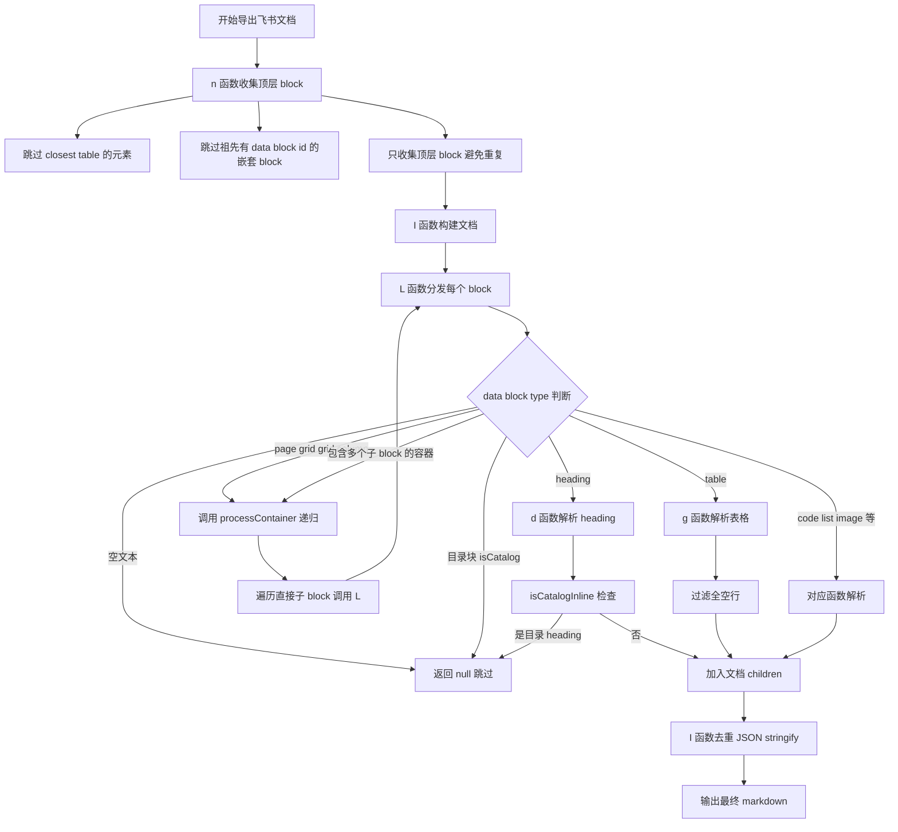

# 飞书导出 Markdown 表格与段落格式错乱问题修复说明

> 项目: 飞书文档导出专家 Chrome 扩展
> 适用版本: content.js v1.0.2 及之后
> 最后更新: 2026-10-19

---

## 一、问题现象

导出飞书文档为 Markdown（不包含图片）时，出现以下三类错乱:

### 1. 表格内容双重输出
表格的内容会在表格之后被重复输出, 每个 cell 内容作为独立段落出现一次, 伴随大量零宽空格和空行.

### 2. 目录块被当作 heading 输出
飞书自动生成的目录块被错误地导出成一长串带链接的 heading 行:

```markdown
# [标题1](#xxx)[标题2](#xxx)[标题3](#xxx)...
```

且因 DOM 嵌套被多次收集, 同一个目录重复出现 7~38 次, 中间夹杂 "本文引用" "关系图推荐" 等侧边栏内容, 把正文段落结构完全打乱.

### 3. 超大容器内容合并成超长行
某个包含几十个子 block 的容器块被当作 heading 处理, `a(e)` 递归收集所有文本后合并成一个 3000+ 字符的超长行, 表格/目录/评论/侧边栏内容全部混在一行里.

---

## 二、根因分析

### 2.1 表格双重输出 - n 函数收集范围错误

`n` 块收集器用 `document.querySelectorAll('[data-record-id]')` 和 `[data-block-id]` 在**整个文档范围**递归查找, 把飞书表格内的 `<tr>` / `<td>` 也当作顶层 block 收集, 导致 cell 内容被双重输出 (一次在表格内, 一次作为独立段落).

### 2.2 零宽空格未清理 - o 函数遗漏

飞书 DOM 在文本节点里插入了大量零宽空格 (`U+200B`-`U+200D`, `U+FEFF`, `U+00A0`) 作为光标占位符, `o` 函数收集文本时未清洗, 全部残留到 markdown 输出.

### 2.3 表格空行未过滤 - g 函数遗漏

飞书表格 DOM 中存在大量所有 cell 内容均为空的占位 `<tr>`, 被原样导出成 `|  |  | ... |` 空行, 干扰阅读.

### 2.4 目录块未识别 - isCatalog 启发式不足

飞书目录块的链接 href 可能是 URL 编码的 `%23xxx`, CSS 选择器 `a[href^="#"]` 匹配不到, 导致 `isCatalog` 返回 false, 目录块被当作 heading 输出.

### 2.5 超大容器被当作 heading - L 函数兜底缺陷

`L` 分发器的 heading 兜底检测 `u(e)` 会用 `e.querySelector('h1, h2, h3, h4, h5, h6')` 检查块内是否有 heading 元素. 超大容器因内部嵌套了 `<h1>` (比如目录的标题), 被误判为 heading, 然后 `a(e)` 递归收集所有文本合并成一串, 表格结构丢失.

---

## 三、修复方案

### 3.1 修复总览

| 函数 | 问题 | 修复 |
| --- | --- | --- |
| `n` 块收集器 | 表格 cell 被双重收集; 嵌套 block 重复收集 | 跳过 `closest('table')` 命中的元素; 跳过祖先有 `data-block-id` 的嵌套 block |
| `o` 文本收集 | 零宽空格未清理 | TEXT_NODE / `<a>` / `<code>` 三处统一用 `replace(/[\u200B-\u200D\uFEFF\u00A0]/g, '')` 清洗 |
| `g` 表格解析 | 空占位行未过滤 | rows 末尾追加 `.filter()` 丢弃所有 cell 均为空的行 |
| `isCatalog` | URL 编码的 href 匹配不到 | 改用 `c()` 解码 href 后检查 `startsWith('#')` |
| `isCatalogInline` 新增 | DOM 层面 isCatalog 失效时无兜底 | 直接检查解析后的 inline 内容, heading 的 link marks 文本 > 20 字符且占 80% 以上则过滤 |
| `processContainer` 新增 | 超大容器被当作 heading | 递归处理容器的直接子 block, 保留 table/heading/code 等结构 |
| `L` 分发器 | page/grid 返回 null 丢内容; 容器走 u(e) 误判 | page/grid/grid_column 改调 `processContainer`; 容器检测放在 `u(e)` 之前 |
| `I` 构建器 | 重复 block; 容器 children 未展开 | `JSON.stringify` 去重; 展开 `container` 类型 children 到文档顶层 |

### 3.2 修复流程图



### 3.3 关键代码片段

#### n 函数 - 跳过嵌套 block

```javascript
// 跳过嵌套 block: 祖先也有 data-block-id, 避免重复收集
// 嵌套 block 会通过容器递归处理(processContainer)被解析
if (e.parentElement?.closest(`[data-block-id]`)) continue;
```

#### o 函数 - 过滤零宽空格

```javascript
let r = (e.textContent || ``).replace(/[\u200B-\u200D\uFEFF\u00A0]/g, ``);
```

#### g 函数 - 过滤空行

```javascript
rows: n
  .slice(1)
  .map(...)
  .filter((e) => e.some((e) => e.children.some((e) => e.content && e.content.trim())))
```

#### processContainer - 递归处理容器

```javascript
function processContainer(e) {
  let t = [];
  let n = e.querySelectorAll(`[data-block-id]`);
  for (let r of Array.from(n)) {
    // 判断 r 是否是 e 的直接子 block
    let p = r.parentElement;
    let isDirect = !0;
    while (p && p !== e) {
      if (p.hasAttribute && p.hasAttribute(`data-block-id`)) {
        isDirect = !1;
        break;
      }
      p = p.parentElement;
    }
    if (!isDirect) continue;
    if (r.closest(`table`) && r !== e) continue;
    let parsed = L(r);
    if (parsed !== null) t.push(parsed);
  }
  return t.length === 0 ? null : { type: `container`, children: t };
}
```

#### I 函数 - 展开 container

```javascript
if (e.type === `container`) {
  for (let c of e.children) {
    let k = JSON.stringify(c);
    if (n.has(k)) continue;
    n.add(k);
    t.push(c);
  }
  continue;
}
```

---

## 四、类比理解

可以把飞书文档导出想象成**搬家整理物品**:

- **飞书 DOM** = 原来的房子, 里面有各种柜子(容器)、抽屉(嵌套 block)、物品(内容 block)
- **n 函数** = 搬家公司去房子里取东西
- **L 函数** = 到了新家后按物品种类分类摆放

### 旧版本的问题

1. **表格双重输出**: 搬家公司把抽屉里的东西拿出来单独装了一箱, 但抽屉本身又连着柜子被搬了一次, 同一个东西出现了两次
2. **零宽空格**: 物品上贴的标签纸没撕干净, 留了一堆透明胶带印子
3. **目录块误判**: 把"物品清单"这张纸当成了大标题贴在墙上, 还重复贴了 38 张
4. **超大容器合并**: 把整个客厅的所有东西倒进一个超大的箱子里, 也不分类, 到了新家打开一看全混在一起

### 新版本的修复

1. **跳过嵌套 block**: 只搬最外层的柜子, 柜子里的抽屉让搬家公司到了新家再拆开分类(递归处理)
2. **过滤零宽空格**: 入住前把所有标签纸撕干净
3. **isCatalog 识别目录**: 看到物品清单直接丢掉, 不贴墙上
4. **processContainer 递归处理**: 大箱子到了新家打开, 里面的东西按原样分类摆好, 而不是全部倒成一堆

---

## 五、测试验证

### 5.1 单元测试

测试脚本: `dev-examples/table-fix-example.js`

运行: `node dev-examples/table-fix-example.js`

| 测试 | 验证内容 | 结果 |
| --- | --- | --- |
| test1 | n 函数跳过 table 内部元素 | 通过 |
| test2 | o 函数过滤零宽空格 | 通过 |
| test3 | g 函数过滤全空行 | 通过 |
| test4 | isCatalog 识别目录块, 正常段落不被误判 | 通过 |
| test5 | I 去重 + isCatalogInline 过滤目录 heading | 通过 |
| test6 | n 跳过嵌套 block + processContainer 递归处理 | 通过 |

### 5.2 语法检查

```
node --check content.js
```

---

## 六、注意事项

### 6.1 processContainer 的递归深度

`processContainer` 调用 `L(r)`, 如果 `r` 也是容器, `L(r)` 会再次调用 `processContainer(r)`, 形成递归. 飞书文档通常嵌套不深 (3~5 层), 不会栈溢出. 但如果遇到异常深嵌套的文档, 需要注意.

### 6.2 JSON.stringify 去重的性能

`I` 函数用 `JSON.stringify(parsed)` 作为 key 去重. 对于大型文档 (几百个 block), 序列化和 Set 操作的性能可以接受, 但超大文档可能较慢.

### 6.3 isCatalogInline 的误判风险

`isCatalogInline` 判断 heading 的 link marks 文本占比 > 80% 且 > 20 字符就过滤. 正常 heading 很少有大量链接, 误判风险低. 但如果某个 heading 确实包含大量链接 (比如 "参见 [文档1](#a) [文档2](#b) ..."), 可能被误过滤.

### 6.4 飞书 DOM 结构可能变化

本修复基于 2026-10 的飞书 DOM 结构. 如果飞书更新了 DOM 结构 (比如改变 `data-block-type` 的值, 或改变目录块的渲染方式), 可能需要重新调整 `isCatalog` 和 `processContainer` 的判断逻辑.

---

## 七、提交记录

| commit | 说明 |
| --- | --- |
| `b47ad82` | 表格双重输出/零宽空格/空行修复 (n/o/g 三处) |
| `57f8200` | 跳过飞书目录块, 去重重复 block |
| `7c5268f` | 兜底过滤目录 heading (isCatalogInline) |
| `9d30f52` | prettier 格式化 content.js, 超大容器跳过 (后被替换) |
| `f460ee3` | 超大容器递归处理子 block, 保留表格等结构 |

---

## 八、引用说明

- [飞书开放平台 - 文档块类型说明](https://open.feishu.cn/document/server-docs/docs/docs-overview/overview)
- [Chrome Extensions - Content Scripts](https://developer.chrome.com/docs/extensions/mv3/content_scripts/)
- [MDN - Element.querySelectorAll](https://developer.mozilla.org/zh-CN/docs/Web/API/Element/querySelectorAll)
- [MDN - Element.closest](https://developer.mozilla.org/zh-CN/docs/Web/API/Element/closest)
- [Unicode 零宽字符说明](https://en.wikipedia.org/wiki/Zero-width_space)
- [Markdown 表格语法](https://www.markdownguide.org/extended-syntax/#tables)
- [Prettier 代码格式化工具](https://prettier.io/)
