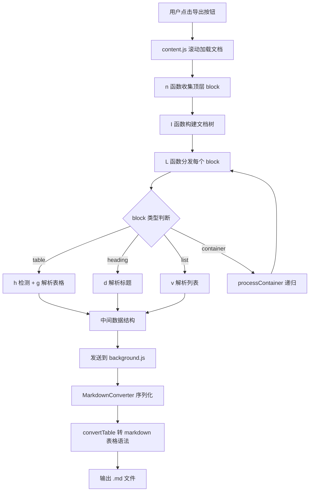
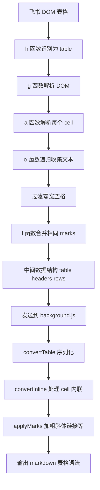
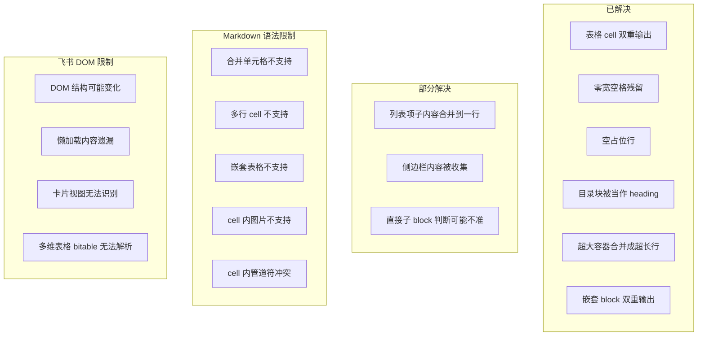

# 飞书文档表格转 Markdown 的实现原理

> 项目: 飞书文档导出专家 Chrome 扩展
> 涉及文件: content.js, background.js
> 最后更新: 2026-10-19

---

## 一、飞书文档的原始格式

飞书文档在浏览器中**不是静态 HTML 文件**, 而是一个 **SPA(单页应用)**, 通过 JavaScript 动态渲染. 文档内容在浏览器里呈现为 **HTML DOM 树**, 每个文档块(block)用以下属性标记:

| 属性 | 作用 |
| --- | --- |
| `data-block-type` | 块类型(text / heading1 / table / code / bullet / image ...) |
| `data-block-id` | 块唯一 ID |
| `data-record-id` | 多维表格(bitable)记录 ID |

一个飞书表格在 DOM 里大致长这样:

```html
<div data-block-type="table" data-block-id="tbl-001">
  <table>
    <tbody>
      <tr>
        <td><div class="cell-content">阶段</div></td>
        <td><div class="cell-content">信息展示内容</div></td>
      </tr>
      <tr>
        <td><div class="cell-content">牌墙</div></td>
        <td><div class="cell-content">无牌墙，设置中也无法打开</div></td>
      </tr>
    </tbody>
  </table>
</div>
```

飞书还会在文本节点里插入**零宽空格**(`U+200B`)作为光标占位符, 在表格 DOM 里存在**合并单元格**和**空占位行**, 这些都需要在转换时处理.

---

## 二、整体导出流程



---

## 三、表格识别 - h 函数

`content.js` 中的 `h(e)` 函数负责判断一个 DOM 块是不是表格:

```javascript
function h(e) {
  return (
    (e.getAttribute(`data-block-type`) || ``) === `table` ||  // 飞书标记
    !!e.querySelector(`table`)                                 // 兜底: 有 <table> 元素
  );
}
```

两种识别方式:
1. **主路径**: 检查 `data-block-type` 属性是否为 `table`(飞书标准标记)
2. **兜底**: 块内是否有 `<table>` 元素(应对标记缺失的情况)

---

## 四、表格解析 - g 函数

`g(e)` 把 DOM 表格解析成**中间数据结构**, 这一步是 DOM 到数据的桥梁:

```javascript
function g(e) {
  let t = e.querySelector(`table`) || e,       // 找到 <table> 元素
    n = Array.from(t.querySelectorAll(`tr`)); // 收集所有 <tr>
  if (n.length === 0) return { type: `table`, headers: [], rows: [] };
  let r = n[0];  // 第一行作为表头
  return {
    type: `table`,
    headers: Array.from(r.querySelectorAll(`th, td`))
      .map((e) => ({ children: a(e) })),       // 每个 cell 的内容用 a() 解析
    rows: n
      .slice(1)                                 // 剩余行作为数据行
      .map((e) => Array.from(e.querySelectorAll(`td, th`))
        .map((e) => ({ children: a(e) })))
      .filter((e) => e.some((e) =>              // 过滤全空行
        e.children.some((e) => e.content && e.content.trim())
      ))
  };
}
```

### 4.1 中间数据结构

解析后的表格结构如下:

```javascript
{
  type: "table",
  headers: [
    { children: [{ type: "text", content: "阶段", marks: [] }] },
    { children: [{ type: "text", content: "信息展示内容", marks: [] }] }
  ],
  rows: [
    [
      { children: [{ type: "text", content: "牌墙", marks: [] }] },
      { children: [{ type: "text", content: "无牌墙", marks: [] }] }
    ]
  ]
}
```

### 4.2 cell 内容解析 - a 函数

每个 cell 的内容用 `a(e)` 解析, 它递归遍历 DOM 节点, 收集文本和样式标记(marks):

```javascript
function a(e) {
  let t = [];
  return (o(e, [], t), l(t));  // o 递归收集, l 合并连续相同 marks
}
```

`o(e, t, n)` 递归逻辑:
- **文本节点**: 收集 textContent, 过滤零宽空格
- **`<a>` 标签**: 提取 href, 生成 `{type:'link', url}` mark
- **`<code>` 标签**: 生成 `{type:'code'}` mark
- **`<b>`/`<strong>`**: 生成 `{type:'bold'}` mark
- **`<i>`/`<em>`**: 生成 `{type:'italic'}` mark

### 4.3 关键修复点

| 问题 | 修复 |
| --- | --- |
| 零宽空格残留 | `o` 函数 TEXT_NODE / `<a>` / `<code>` 三处统一 `replace(/[\u200B-\u200D\uFEFF\u00A0]/g, '')` |
| 空占位行 | `g` 末尾 `.filter()` 丢弃所有 cell 均为空的行 |
| 表格 cell 被双重收集 | `n` 函数跳过 `closest('table')` 命中的元素 |

---

## 五、Markdown 序列化 - convertTable

`background.js` 中的 `MarkdownConverter.convertTable(e, t)` 把中间结构转成 markdown 表格文本:

```javascript
convertTable(e, t) {
  return e.headers.length === 0 ? `` : [
    `| ` + e.headers.map(e => this.convertInline(e.children, t)).join(` | `) + ` |`,                    // 表头行
    `| ` + e.headers.map(() => `---`).join(` | `) + ` |`,                                                  // 分隔行
    ...e.rows.map(e => `| ` + e.map(e => this.convertInline(e.children, t)).join(` | `) + ` |`)            // 数据行
  ].join(`\n`);
}
```

### 5.1 转换过程示例

输入中间结构:
```javascript
{
  type: "table",
  headers: [
    { children: [{ type: "text", content: "阶段", marks: [] }] },
    { children: [{ type: "text", content: "信息展示内容", marks: [] }] }
  ],
  rows: [
    [
      { children: [{ type: "text", content: "牌墙", marks: [] }] },
      { children: [{ type: "text", content: "无牌墙", marks: [] }] }
    ]
  ]
}
```

输出 markdown:
```markdown
| 阶段 | 信息展示内容 |
| --- | --- |
| 牌墙 | 无牌墙 |
```

### 5.2 cell 内联样式转换 - convertInline

`convertInline(e, t)` 把 cell 的 children 数组转成带样式的文本:

```javascript
convertInline(e, t) {
  return e.map(e => this.applyMarks(e.content, e.marks)).join(``);
}

applyMarks(e, t) {
  let n = e;
  for (let e of t) switch (e.type) {
    case `bold`:       n = `**${n}**`; break;     // **加粗**
    case `italic`:     n = `*${n}*`; break;       // *斜体*
    case `strikethrough`: n = `~~${n}~~`; break;  // ~~删除线~~
    case `code`:       n = `\`${n}\``; break;     // `行内代码`
    case `link`:       n = `[${n}](${e.url})`; break;  // [文本](url)
    case `underline`:  n = `<u>${n}</u>`; break;
    case `highlight`:  n = `==${n}==`; break;
  }
  return n;
}
```

---

## 六、完整转换流程图



---

## 七、类比理解

可以把整个流程想象成**翻译一封外文信件**:

| 阶段 | 类比 | 实际 |
| --- | --- | --- |
| 飞书 DOM | 原始外文信件, 带各种格式标记 | HTML DOM 树, 带 `data-block-type` 等属性 |
| n 函数收集 | 邮递员把信件从信箱取出 | `querySelectorAll` 收集所有 block |
| g 函数解析 | 翻译员读懂信件结构(段落/表格/列表) | DOM 转中间数据结构 |
| a 函数 | 逐字翻译, 保留加粗/斜体等格式 | 递归收集文本 + marks |
| 零宽空格过滤 | 擦掉信件上的污渍 | `replace` 清洗不可见字符 |
| convertTable | 按中文信件格式重新排版 | 中间结构转 markdown 语法 |
| applyMarks | 还原加粗/斜体/链接 | marks 转成 `**` `*` `[]()` 等 |

---

## 八、表格解析问题全记录

### 8.1 已解决的问题

#### 问题 1: 表格 cell 双重输出

**现象**: 表格的内容在表格之后被重复输出, 每个 cell 内容作为独立段落出现一次.

**根因**: `n` 函数用 `document.querySelectorAll('[data-block-id]')` 在整个文档范围递归查找, 把飞书表格内的 `<tr>` / `<td>` 也当作顶层 block 收集, 导致 cell 内容被双重输出(一次在表格内, 一次作为独立段落).

**修复**: `n` 函数跳过 `closest('table')` 命中的元素, 表格内部元素不作为顶层 block 收集.

```javascript
if (e.closest(`table`)) continue;
```

#### 问题 2: 零宽空格残留

**现象**: 导出的 markdown 里到处都是不可见字符, 导致渲染异常.

**根因**: 飞书 DOM 在文本节点里插入了大量零宽空格(`U+200B`-`U+200D`, `U+FEFF`, `U+00A0`)作为光标占位符, `o` 函数收集文本时未清洗.

**修复**: `o` 函数在 TEXT_NODE / `<a>` / `<code>` 三处统一清洗.

```javascript
let r = (e.textContent || ``).replace(/[\u200B-\u200D\uFEFF\u00A0]/g, ``);
```

#### 问题 3: 空占位行

**现象**: 表格后面出现大量 `|  |  |  |` 空行.

**根因**: 飞书表格 DOM 中存在大量所有 cell 内容均为空的占位 `<tr>`, 被原样导出.

**修复**: `g` 函数末尾追加 `.filter()`, 丢弃所有 cell 均为空的行.

```javascript
.filter((e) => e.some((e) => e.children.some((e) => e.content && e.content.trim())))
```

#### 问题 4: 目录块被当作 heading 输出

**现象**: 飞书自动生成的目录块被导出成一长串带链接的 heading 行 `# [标题1](#xxx)[标题2](#xxx)...`, 且重复出现 7~38 次.

**根因**: 
1. 目录块的 href 可能是 URL 编码的 `%23xxx`, CSS 选择器 `a[href^="#"]` 匹配不到
2. 目录块因 DOM 嵌套被多次收集
3. 目录块内有 `<h1>`, 被 `u(e)` 误判为 heading

**修复**: 
- `isCatalog` 改用 `c()` 解码 href 后检查 `startsWith('#')`
- 新增 `isCatalogInline` 直接检查解析后的 inline 内容(heading 的 link marks 文本 > 20 字符且占 80% 以上则过滤)
- `I` 函数用 `JSON.stringify` 去重

#### 问题 5: 超大容器内容合并成超长行

**现象**: 某个包含几十个子 block 的容器块被当作 heading 处理, 输出一个 3000+ 字符的超长行, 表格/目录/评论/侧边栏内容全混在一行.

**根因**: `L` 分发器的 heading 兜底检测 `u(e)` 用 `e.querySelector('h1, h2, h3, h4, h5, h6')` 检查块内是否有 heading 元素. 超大容器因内部嵌套了 `<h1>` 被误判为 heading, `a(e)` 递归收集所有文本合并成一串.

**修复**: 
- 新增 `processContainer` 函数递归处理容器的直接子 block
- `L` 函数在 `u(e)` 之前检测容器(包含多个 `[data-block-id]` 后代), 调用 `processContainer`
- `page` / `grid` / `grid_column` 不再返回 null, 改为调用 `processContainer`

#### 问题 6: 嵌套 block 双重输出

**现象**: 表格被输出两次(一次残缺 2 行, 一次完整 9 行), 列表项的子内容也被独立输出.

**根因**: `n` 函数同时收集了容器和内部子 block, `processContainer` 也处理了子 block, 去重只对完全相同的内容生效, 内容不同的重复无法消除.

**修复**: `n` 函数跳过嵌套 block(祖先有 `data-block-id` 或 `data-record-id`), 只收集顶层 block. 嵌套 block 通过 `processContainer` 递归处理.

```javascript
if (e.parentElement?.closest(`[data-block-id], [data-record-id]`)) continue;
```

### 8.2 部分解决仍有残留的问题

#### 问题 7: 列表项子内容被合并到一行

**现象**: 飞书的列表项内嵌套了子列表项, 子列表项被合并到父列表项的一行里, 同时又被独立输出.

```
- •【产品数据】当前卡五星好友房DAU为：◦卡五星：1300◦孝感卡五星：130+
- ◦卡五星：1300
- ◦孝感卡五星：130+
```

**根因**: `a(e)` 递归收集所有文本, 把子列表项的文本合并到父列表项里. 同时子列表项是独立的 block(有 `data-block-id`), 被独立收集输出.

**当前状态**: 跳过嵌套 block 后, 子列表项不再被独立收集. 但父列表项的 `a(e)` 仍然把子内容合并到一行, 子列表项的结构(缩进、层级)丢失.

**无法完全解决的原因**: `a(e)` 的设计是递归收集所有文本, 不识别嵌套的 block 结构. 要正确处理嵌套列表, 需要 `a(e)` 能识别子 block 的边界并生成嵌套的 list 结构, 这需要重构整个解析逻辑.

#### 问题 8: 侧边栏内容被收集

**现象**: 导出的 markdown 里出现 "本文暂未被其它文档引用" "关系图推荐内容由 AI 生成" "真诚点赞，手留余香" 等侧边栏内容.

**根因**: 这些内容在飞书 DOM 里有 `data-block-id` 或 `data-record-id`, 被 `n` 函数收集.

**当前状态**: 没有专门的过滤逻辑. 这些内容会被当作普通 block 输出.

**无法完全解决的原因**: 侧边栏内容与正文内容在 DOM 层面没有明确的区分标记, 无法用统一规则过滤. 需要针对每种侧边栏元素(评论、引用、AI 推荐)写专门的过滤逻辑.

#### 问题 9: processContainer 的"直接子 block"判断可能不准确

**现象**: 如果飞书 DOM 的 block 嵌套层次很深, `processContainer` 可能只处理了部分子 block.

**根因**: `processContainer` 的"直接子 block"判断逻辑: 从 `r.parentElement` 向上找, 遇到 `e` 之前不能有其他 `data-block-id`. 如果飞书 DOM 有多层中间容器(没有 `data-block-id`), 判断可能出错.

**当前状态**: 对于飞书的标准 DOM 结构, 判断是准确的. 但如果飞书改变了 DOM 结构, 可能需要调整.

### 8.3 无法解决的问题(Markdown 语法的固有限制)

#### 限制 1: 合并单元格(colspan/rowspan)

**问题**: 飞书表格如果使用了合并单元格, 转换后会丢失合并信息.

**原因**: Markdown 表格语法不支持 colspan/rowspan. `g` 函数用 `querySelectorAll('td, th')` 收集每个 cell, 不识别合并属性.

**影响**: 合并的 cell 会被拆分成多个独立 cell, 或者空 cell.

**无法解决**: Markdown 标准没有合并单元格的语法. 如果需要保留合并信息, 只能用 HTML 表格代替 Markdown 表格.

#### 限制 2: 多行 cell 内容

**问题**: 飞书 cell 内的列表、多段落、代码块等内容, 转换后被合并成一串文本.

**原因**: Markdown 表格的 cell 是单行的, 不能包含换行. `a(e)` 递归收集所有文本, 把多行内容合并.

**影响**: cell 内的列表项 `•` `◦` 等符号被保留, 但结构丢失(没有换行和缩进).

**无法解决**: Markdown 表格 cell 不支持多行内容. 可以用 `<br>` 标签模拟换行, 但不是所有 Markdown 渲染器都支持.

#### 限制 3: 嵌套表格

**问题**: 飞书表格内嵌套了另一个表格, 转换后内层表格被展平.

**原因**: Markdown 不支持表格嵌套. `g` 函数用 `querySelectorAll('tr')` 收集所有 `<tr>`, 包括嵌套表格的行, 导致行数错误.

**影响**: 嵌套表格的行被混入外层表格, 列数可能不匹配.

**无法解决**: Markdown 标准不支持嵌套表格. 如果需要保留嵌套结构, 只能用 HTML 表格.

#### 限制 4: cell 内的图片

**问题**: 飞书 cell 内有图片, 转换后图片丢失或显示异常.

**原因**: Markdown 表格 cell 不支持图片语法 ``. `a(e)` 把图片的 alt 文本收集到 cell 内容里, 但图片本身丢失.

**影响**: cell 内只显示图片的 alt 文本(如果有), 或者空白.

**无法解决**: Markdown 表格 cell 不支持图片. 可以用 HTML `` 标签, 但不是所有渲染器都支持.

#### 限制 5: cell 内的样式可能冲突

**问题**: cell 内的加粗、斜体等样式可能与表格管道符 `|` 冲突.

**原因**: 如果 cell 内容包含 `|` 字符(如 `**加粗|文本**`), Markdown 解析器可能误认为是列分隔符.

**影响**: 表格列数错乱.

**无法解决**: Markdown 表格用 `|` 作为列分隔符, cell 内的 `|` 需要用 `\|` 转义. 当前实现没有做转义处理.

### 8.4 飞书 DOM 相关的无法解决的问题

#### 问题 10: 飞书 DOM 结构可能变化

**问题**: 本实现基于 2026-10 的飞书 DOM 结构. 如果飞书更新了 DOM 结构, 可能导致解析失败.

**无法解决**: 飞书没有公开文档保证 DOM 结构的稳定性. `data-block-type` 的值、block 的嵌套方式、表格的渲染方式都可能变化.

**应对**: 定期用真实飞书文档测试, 发现问题及时调整 `h` / `g` / `processContainer` 的判断逻辑.

#### 问题 11: 懒加载内容遗漏

**问题**: 飞书文档是 SPA, 内容懒加载. 如果文档很长, 滚动收集可能遗漏未加载的内容.

**当前状态**: `t` 函数(滚动收集器)会逐步滚动文档, 触发懒加载. 但如果某些内容需要特定操作(如点击"展开"按钮)才加载, 会遗漏.

**无法完全解决**: 无法预知哪些内容需要交互才加载. 可以增加滚动等待时间, 但影响导出速度.

#### 问题 12: 飞书表格的"卡片视图"

**问题**: 飞书的某些表格使用了"卡片视图"或"看板视图", 不是标准 `<table>` 结构, 而是用 `<div>` 模拟的卡片布局.

**无法解决**: `h` 函数检测 `data-block-type === 'table'` 或 `<table>` 元素. 卡片视图没有 `<table>` 元素, 不会被识别为表格, 会走 paragraph 兜底, 内容被合并.

#### 问题 13: 飞书多维表格(bitable)

**问题**: 飞书的多维表格(bitable)不是标准文档表格, 而是类似 Excel 的数据表, 用 `data-record-id` 标记记录.

**当前状态**: `n` 函数会收集 `data-record-id` 的元素. 但 bitable 的 DOM 结构与普通表格不同, `g` 函数可能无法正确解析.

**无法完全解决**: bitable 的 DOM 结构复杂, 且可能用 iframe 渲染(跨域无法访问). 需要专门的解析逻辑.

---

## 九、问题分类汇总



---

## 十、注意事项

### 10.1 导出前检查

- 大型文档建议先在飞书页面**滚动到底**, 确保内容加载完成
- 包含多维表格(bitable)的文档, bitable 内容可能无法正确导出
- 包含"卡片视图"表格的文档, 卡片内容会被合并成段落

### 10.2 性能考虑

- `a(e)` 递归遍历 DOM, 对于大型表格(几百行)可能较慢
- `JSON.stringify` 去重对大型文档有性能开销, 但可接受
- `processContainer` 递归处理嵌套容器, 深层嵌套可能栈溢出(飞书通常 3~5 层, 不会溢出)

### 10.3 导出后检查

- 检查表格列数是否一致(管道符 `|` 冲突会导致列数错乱)
- 检查是否有侧边栏内容混入("本文引用"等)
- 检查列表项的子内容是否被合并(无法完全避免)

### 10.4 飞书 DOM 结构可能变化

本实现基于 2026-10 的飞书 DOM 结构. 如果飞书更新了 DOM 结构(如改变 `data-block-type` 的值, 或改变表格的渲染方式), 可能需要调整 `h` / `g` / `processContainer` 的判断逻辑.

---

## 十一、引用说明

- [飞书开放平台 - 文档块类型说明](https://open.feishu.cn/document/server-docs/docs/docs-overview/overview)
- [Chrome Extensions - Content Scripts](https://developer.chrome.com/docs/extensions/mv3/content_scripts/)
- [Chrome Extensions - Message Passing](https://developer.chrome.com/docs/extensions/mv3/messaging/)
- [MDN - Element.querySelectorAll](https://developer.mozilla.org/zh-CN/docs/Web/API/Element/querySelectorAll)
- [MDN - Element.closest](https://developer.mozilla.org/zh-CN/docs/Web/API/Element/closest)
- [MDN - Node.cloneNode](https://developer.mozilla.org/zh-CN/docs/Web/API/Node/cloneNode)
- [Markdown 表格语法 - Markdown Guide](https://www.markdownguide.org/extended-syntax/#tables)
- [Unicode 零宽字符说明 - Wikipedia](https://en.wikipedia.org/wiki/Zero-width_space)
- 项目源码: [feishu-export-markdown](https://github.com/mickorz/feishu-export-markdown)
  - `content.js` - DOM 解析与 block 收集
  - `background.js` - Markdown 序列化
  - `dev-examples/table-fix-example.js` - 单元测试
