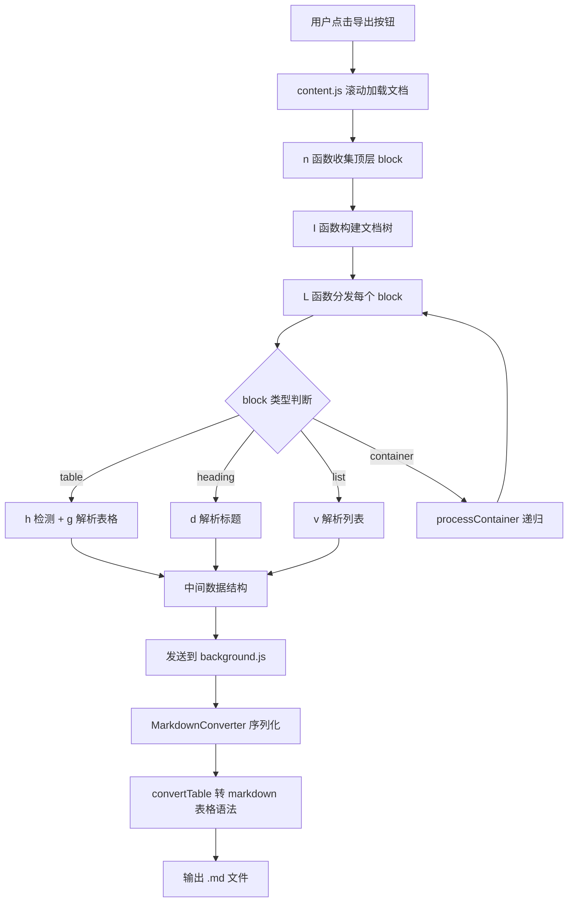
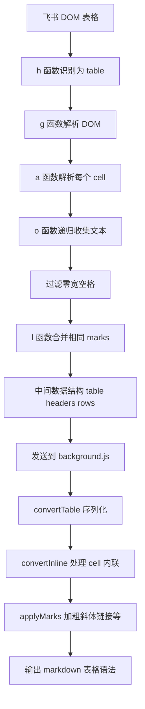

# 飞书文档表格转 Markdown 的实现原理

> 项目: 飞书文档导出专家 Chrome 扩展
> 涉及文件: content.js, background.js
> 最后更新: 2026-10-19

---

## 一、飞书文档的原始格式

飞书文档在浏览器中**不是静态 HTML 文件**, 而是一个 **SPA(单页应用)**, 通过 JavaScript 动态渲染. 文档内容在浏览器里呈现为 **HTML DOM 树**, 每个文档块(block)用以下属性标记:

| 属性 | 作用 |
| --- | --- |
| `data-block-type` | 块类型(text / heading1 / table / code / bullet / image ...) |
| `data-block-id` | 块唯一 ID |
| `data-record-id` | 多维表格(bitable)记录 ID |

一个飞书表格在 DOM 里大致长这样:

```html
<div data-block-type="table" data-block-id="tbl-001">
  <table>
    <tbody>
      <tr>
        <td><div class="cell-content">阶段</div></td>
        <td><div class="cell-content">信息展示内容</div></td>
      </tr>
      <tr>
        <td><div class="cell-content">牌墙</div></td>
        <td><div class="cell-content">无牌墙，设置中也无法打开</div></td>
      </tr>
    </tbody>
  </table>
</div>
```

飞书还会在文本节点里插入**零宽空格**(`U+200B`)作为光标占位符, 在表格 DOM 里存在**合并单元格**和**空占位行**, 这些都需要在转换时处理.

---

## 二、整体导出流程



---

## 三、表格识别 - h 函数

`content.js` 中的 `h(e)` 函数负责判断一个 DOM 块是不是表格:

```javascript
function h(e) {
  return (
    (e.getAttribute(`data-block-type`) || ``) === `table` ||  // 飞书标记
    !!e.querySelector(`table`)                                 // 兜底: 有 <table> 元素
  );
}
```

两种识别方式:
1. **主路径**: 检查 `data-block-type` 属性是否为 `table`(飞书标准标记)
2. **兜底**: 块内是否有 `<table>` 元素(应对标记缺失的情况)

---

## 四、表格解析 - g 函数

`g(e)` 把 DOM 表格解析成**中间数据结构**, 这一步是 DOM 到数据的桥梁:

```javascript
function g(e) {
  let t = e.querySelector(`table`) || e,       // 找到 <table> 元素
    n = Array.from(t.querySelectorAll(`tr`)); // 收集所有 <tr>
  if (n.length === 0) return { type: `table`, headers: [], rows: [] };
  let r = n[0];  // 第一行作为表头
  return {
    type: `table`,
    headers: Array.from(r.querySelectorAll(`th, td`))
      .map((e) => ({ children: a(e) })),       // 每个 cell 的内容用 a() 解析
    rows: n
      .slice(1)                                 // 剩余行作为数据行
      .map((e) => Array.from(e.querySelectorAll(`td, th`))
        .map((e) => ({ children: a(e) })))
      .filter((e) => e.some((e) =>              // 过滤全空行
        e.children.some((e) => e.content && e.content.trim())
      ))
  };
}
```

### 4.1 中间数据结构

解析后的表格结构如下:

```javascript
{
  type: "table",
  headers: [
    { children: [{ type: "text", content: "阶段", marks: [] }] },
    { children: [{ type: "text", content: "信息展示内容", marks: [] }] }
  ],
  rows: [
    [
      { children: [{ type: "text", content: "牌墙", marks: [] }] },
      { children: [{ type: "text", content: "无牌墙", marks: [] }] }
    ]
  ]
}
```

### 4.2 cell 内容解析 - a 函数

每个 cell 的内容用 `a(e)` 解析, 它递归遍历 DOM 节点, 收集文本和样式标记(marks):

```javascript
function a(e) {
  let t = [];
  return (o(e, [], t), l(t));  // o 递归收集, l 合并连续相同 marks
}
```

`o(e, t, n)` 递归逻辑:
- **文本节点**: 收集 textContent, 过滤零宽空格
- **`<a>` 标签**: 提取 href, 生成 `{type:'link', url}` mark
- **`<code>` 标签**: 生成 `{type:'code'}` mark
- **`<b>`/`<strong>`**: 生成 `{type:'bold'}` mark
- **`<i>`/`<em>`**: 生成 `{type:'italic'}` mark

### 4.3 关键修复点

| 问题 | 修复 |
| --- | --- |
| 零宽空格残留 | `o` 函数 TEXT_NODE / `<a>` / `<code>` 三处统一 `replace(/[\u200B-\u200D\uFEFF\u00A0]/g, '')` |
| 空占位行 | `g` 末尾 `.filter()` 丢弃所有 cell 均为空的行 |
| 表格 cell 被双重收集 | `n` 函数跳过 `closest('table')` 命中的元素 |

---

## 五、Markdown 序列化 - convertTable

`background.js` 中的 `MarkdownConverter.convertTable(e, t)` 把中间结构转成 markdown 表格文本:

```javascript
convertTable(e, t) {
  return e.headers.length === 0 ? `` : [
    `| ` + e.headers.map(e => this.convertInline(e.children, t)).join(` | `) + ` |`,                    // 表头行
    `| ` + e.headers.map(() => `---`).join(` | `) + ` |`,                                                  // 分隔行
    ...e.rows.map(e => `| ` + e.map(e => this.convertInline(e.children, t)).join(` | `) + ` |`)            // 数据行
  ].join(`\n`);
}
```

### 5.1 转换过程示例

输入中间结构:
```javascript
{
  type: "table",
  headers: [
    { children: [{ type: "text", content: "阶段", marks: [] }] },
    { children: [{ type: "text", content: "信息展示内容", marks: [] }] }
  ],
  rows: [
    [
      { children: [{ type: "text", content: "牌墙", marks: [] }] },
      { children: [{ type: "text", content: "无牌墙", marks: [] }] }
    ]
  ]
}
```

输出 markdown:
```markdown
| 阶段 | 信息展示内容 |
| --- | --- |
| 牌墙 | 无牌墙 |
```

### 5.2 cell 内联样式转换 - convertInline

`convertInline(e, t)` 把 cell 的 children 数组转成带样式的文本:

```javascript
convertInline(e, t) {
  return e.map(e => this.applyMarks(e.content, e.marks)).join(``);
}

applyMarks(e, t) {
  let n = e;
  for (let e of t) switch (e.type) {
    case `bold`:       n = `**${n}**`; break;     // **加粗**
    case `italic`:     n = `*${n}*`; break;       // *斜体*
    case `strikethrough`: n = `~~${n}~~`; break;  // ~~删除线~~
    case `code`:       n = `\`${n}\``; break;     // `行内代码`
    case `link`:       n = `[${n}](${e.url})`; break;  // [文本](url)
    case `underline`:  n = `<u>${n}</u>`; break;
    case `highlight`:  n = `==${n}==`; break;
  }
  return n;
}
```

---

## 六、完整转换流程图



---

## 七、类比理解

可以把整个流程想象成**翻译一封外文信件**:

| 阶段 | 类比 | 实际 |
| --- | --- | --- |
| 飞书 DOM | 原始外文信件, 带各种格式标记 | HTML DOM 树, 带 `data-block-type` 等属性 |
| n 函数收集 | 邮递员把信件从信箱取出 | `querySelectorAll` 收集所有 block |
| g 函数解析 | 翻译员读懂信件结构(段落/表格/列表) | DOM 转中间数据结构 |
| a 函数 | 逐字翻译, 保留加粗/斜体等格式 | 递归收集文本 + marks |
| 零宽空格过滤 | 擦掉信件上的污渍 | `replace` 清洗不可见字符 |
| convertTable | 按中文信件格式重新排版 | 中间结构转 markdown 语法 |
| applyMarks | 还原加粗/斜体/链接 | marks 转成 `**` `*` `[]()` 等 |

---

## 八、表格修复历程中的关键决策

### 8.1 双重输出问题

**问题**: `n` 函数用 `document.querySelectorAll('[data-block-id]')` 在整个文档范围收集, 把表格内的 `<tr>` / `<td>` 也当作顶层 block 收集, 导致 cell 内容被输出两次(一次在表格内, 一次作为独立段落).

**修复**: `n` 函数跳过 `closest('table')` 命中的元素, 表格内部元素不作为顶层 block 收集.

### 8.2 超大容器问题

**问题**: 某些包含几十个子 block 的容器块(如 grid/page)被当作 heading 处理, `a(e)` 递归收集所有文本后合并成一个 3000+ 字符的超长行, 表格结构丢失.

**修复**: 新增 `processContainer` 函数递归处理容器的直接子 block, 保留 table/heading/code 等结构. `L` 函数在 `u(e)` 之前检测容器, 避免超大容器因内部有 `<h1>` 被误判为 heading.

### 8.3 嵌套 block 跳过

**问题**: 如果 `n` 函数同时收集容器和内部子 block, 会导致双重输出(去重只对完全相同的内容生效, 内容不同的重复无法消除).

**修复**: `n` 函数跳过祖先有 `data-block-id` 或 `data-record-id` 的嵌套 block, 只收集顶层 block. 嵌套 block 通过 `processContainer` 递归处理.

---

## 九、注意事项

### 9.1 Markdown 表格的局限性

Markdown 表格语法不支持:
- **合并单元格**(colspan/rowspan) - 飞书表格如果有合并单元格, 转换后会丢失合并信息
- **多行 cell 内容** - markdown 表格 cell 是单行的, 飞书 cell 内的列表/多段落会被合并成一串
- **嵌套表格** - markdown 不支持表格嵌套, 内层表格会被展平

### 9.2 性能考虑

- `a(e)` 递归遍历 DOM, 对于大型表格(几百行)可能较慢
- `JSON.stringify` 去重对大型文档有性能开销, 但可接受

### 9.3 飞书 DOM 结构可能变化

本实现基于 2026-10 的飞书 DOM 结构. 如果飞书更新了 DOM 结构(如改变 `data-block-type` 的值, 或改变表格的渲染方式), 可能需要调整 `h` / `g` / `processContainer` 的判断逻辑.

---

## 十、引用说明

- [飞书开放平台 - 文档块类型说明](https://open.feishu.cn/document/server-docs/docs/docs-overview/overview)
- [Chrome Extensions - Content Scripts](https://developer.chrome.com/docs/extensions/mv3/content_scripts/)
- [Chrome Extensions - Message Passing](https://developer.chrome.com/docs/extensions/mv3/messaging/)
- [MDN - Element.querySelectorAll](https://developer.mozilla.org/zh-CN/docs/Web/API/Element/querySelectorAll)
- [MDN - Element.closest](https://developer.mozilla.org/zh-CN/docs/Web/API/Element/closest)
- [MDN - Node.cloneNode](https://developer.mozilla.org/zh-CN/docs/Web/API/Node/cloneNode)
- [Markdown 表格语法 - Markdown Guide](https://www.markdownguide.org/extended-syntax/#tables)
- [Unicode 零宽字符说明 - Wikipedia](https://en.wikipedia.org/wiki/Zero-width_space)
- 项目源码: [feishu-export-markdown](https://github.com/mickorz/feishu-export-markdown)
  - `content.js` - DOM 解析与 block 收集
  - `background.js` - Markdown 序列化
  - `dev-examples/table-fix-example.js` - 单元测试
